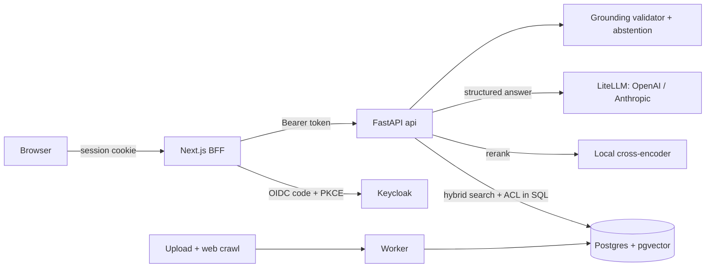

# Grounded RAG Assistant

[](https://github.com/muralikalluri/grounded-rag-assistant/actions/workflows/ci.yml)


A document Q&A assistant that **answers only from your documents, cites the exact passage, says "not found"
instead of guessing, and shows each user only what their group may read.** All companies, people and
documents in the demo are fictional.

> **Demo GIF and Loom walkthrough: not recorded yet** (script in [docs/loom-script.md](docs/loom-script.md)). Run the quickstart below to see it live (ask as Alice, then as Bob).

## Results

<!-- results:start -->
_Generated from [`eval/reports/2026-09-29_no-commits-yet_retrieval-only_2.json`](eval/reports/2026-09-29_no-commits-yet_retrieval-only_2.json) by `make docs`; do not edit by hand._

Run `20260929T040133Z-3c1d04`, mode `retrieval_only`, 30 questions (20 answerable / 6 unanswerable / 4 acl-denied), git `no-commits-yet` (dirty working tree), embeddings `BAAI/bge-small-en-v1.5`, reranker `BAAI/bge-reranker-base`.

Environment: Python 3.12.14, torch 2.14.0, device `mps`.

> **Generation metrics have not been run.** No LLM key was available when this report was produced, so answer correctness, citation precision and abstention accuracy are not measured yet. Run `make eval EVAL_ARGS=--yes` with a key to fill them in.

| Metric | Result |
|---|---|
| Retrieval recall@6, file level | 19/20 (0.95) [95% CI 0.76–0.99] |
| Retrieval recall@6, page level (PDF) | 11/12 (0.92) [95% CI 0.65–0.99] |
| Chunks returned that the asking user may not read | **0** of 180 |
| Forbidden documents retrieved (ACL-denied questions) | **0** |

| SPEC §9.4 target | Goal | Result | Status |
|---|---|---|---|
| Retrieval recall@6 (file level) | >= 0.90 | 19/20 (0.95) [95% CI 0.76–0.99] | not demonstrable at this n |
| Abstention accuracy (unanswerable + ACL-denied) | >= 0.95 | n/a | not run |
| False abstention rate | <= 0.10 | n/a | not run |
| Citation precision | >= 0.90 | n/a | not run |

Status uses the 95% Wilson interval, not the point estimate: at 30 questions most targets cannot be demonstrated either way.
<!-- results:end -->

Numbers above are generated from `eval/reports/*.json` (`make docs`) and never typed by hand.

## Architecture



More detail in [docs/architecture.md](docs/architecture.md).

## Quickstart

Needs Docker. The first run downloads the local embedding and reranker models.

```bash
cp .env.example .env     # placeholders only
make up                  # Postgres, Redis, Keycloak, API, worker, web
make ingest-demo         # index the 100 demo documents
```

Open http://localhost:3000. Demo users (throwaway, local Keycloak only): `alice` / `alice-demo-only` (HR),
`bob` / `bob-demo-only` (Engineering). Answers need `ANTHROPIC_API_KEY` or `OPENAI_API_KEY` in `.env`. Without a key, ingestion and retrieval
still work, and `make e2e` exercises the whole UI with an offline test-mode provider.

`make test` · `make lint` · `make eval EVAL_ARGS=--yes` (live model, costs money) · `make eval-retrieval` (no key).

> The demo Keycloak realm and its passwords are public. Never deploy them.

## Features

- Upload and web-crawl connectors, driven from the CLI/worker (`make ingest-demo`, `make crawl`); robots.txt, SSRF guard, staleness detection
- PDF, DOCX and HTML parsing with page and section anchors; structural chunking
- Hybrid retrieval (vector + keyword, RRF) with a local reranker; ACL applied in SQL on every path
- Citation-checked answers: unsupported sentences are dropped, otherwise "not found"
- Chat UI with a citation panel showing the PDF page and highlighted quote
- Keycloak OIDC, groups drive access; Bob cannot see or cite HR-only documents
- Evaluation harness with confidence intervals, dev/hold-out split and a promotion gate
- Terraform for Azure ([infra/azure](infra/azure/README.md)); structured logs with tokens, latency and cost

## Design decisions

Short ADRs live in [docs/adr](docs/adr): Postgres over a dedicated vector DB, ACLs on chunks, a deterministic
grounding validator, a BFF with server-side sessions, local embeddings, Azure-only Terraform, structured logs.
The threat model is in [docs/security.md](docs/security.md).

## Sample deliverable

[sample-deliverable/POC_HANDOVER.md](sample-deliverable/POC_HANDOVER.md) is what a Starter engagement hands over.

## Status and honest gaps

- Generation metrics need a live LLM key and have not been run; see the Results banner.
- GitHub CI and the Azure `terraform apply` have not been run yet.
- No HTTP API for managing content yet: SPEC §6's `/api/collections`, `/api/collections/{id}/sources`,
  `/api/ingestion/jobs`, `/api/feedback` and `/api/admin/metrics` are not built; only `/api/chat`, the
  citation preview endpoints and health checks exist. Ingestion is via the CLI.
- No thumbs up/down, per-user rate limiting or audit-log UI.
- Not in v0.1.0 by design (SPEC §14 "Later"): Google Drive / SharePoint / database connectors, AWS Terraform,
  OpenTelemetry, dashboards, Entra ID sign-in, CI smoke eval, image publishing.
- The Loom walkthrough and demo GIF are not recorded; the Hire-me link and CI badge owner are placeholders.

## Hire me

Want this on your own documents? [Hire me on Upwork](https://www.upwork.com/freelancers/YOUR-PROFILE).
