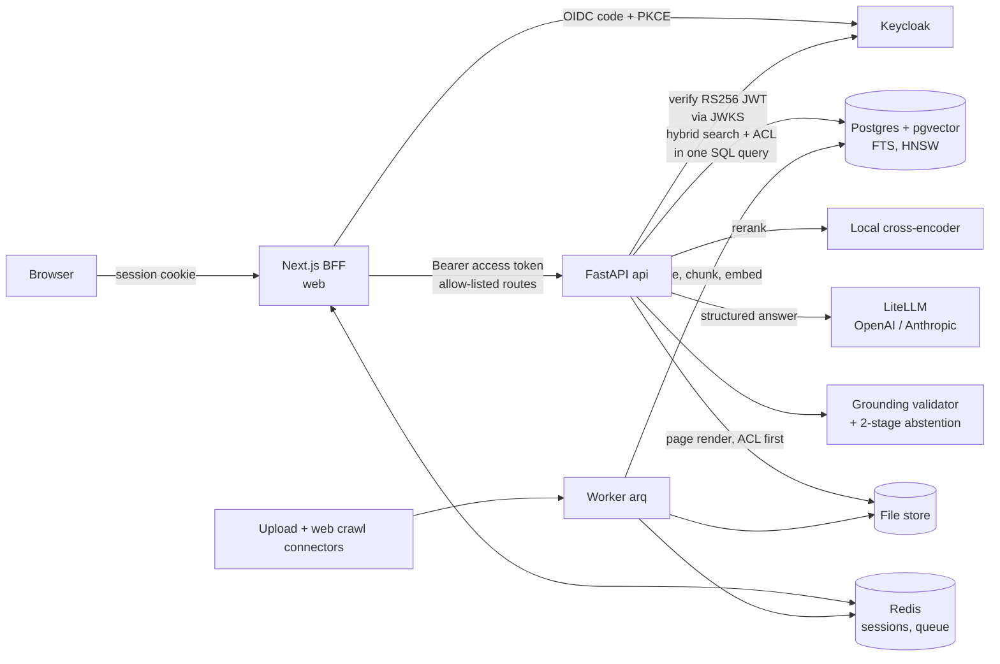

# Architecture

## Request path (`POST /api/chat`)

1. The web BFF swaps the opaque session cookie for the user's access token; the API verifies it and
   derives the user's groups. Nothing about identity is trusted from the browser.
2. **Retrieval** (`app/retrieval`): vector top-k and keyword top-k are each run as SQL that carries the
   ACL predicate (`acl_groups && :groups`), fused with RRF, then reranked locally. There is exactly one
   place that reads `chunks` (the scoped query builder), enforced by static and runtime tests.
3. **Stage-1 abstention:** if the best rerank probability is below `abstain_rerank_threshold`, answer
   "not found" without calling an LLM.
4. **Generation:** the LLM sees sources as aliases `S1..Sn` and returns JSON sentences with quotes.
5. **Grounding validator:** each citation must name a real source and quote it verbatim (word-bounded
   exact, or strict token-equal fuzzy); numbers, dates and negations in a sentence must be inside the
   cited quote. Failing sentences are dropped; if none survive the answer becomes "not found"
   (stage-2 abstention). The validator, not the model, decides what the user sees.
6. Progress and the result stream to the browser as SSE with exactly one closing event.
7. **Citation panel:** the UI asks for the cited chunk's page image and quote rectangles. All three endpoints (chunk, page image, locate)
   are keyed by chunk id, check ACL before any file I/O, and answer a denied chunk exactly like a
   missing one (identical 404).

## Ingestion

Connector -> `RawDocument` -> parser (PDF/DOCX/HTML/text) -> structural chunker (480 tokens, 15% overlap,
page and section anchors) -> local embeddings -> one transaction per document. ACLs come from the
collection and are copied onto every chunk; changing a collection ACL updates chunks under a row lock so
an ingest can never race it. The web crawler is SSRF-guarded (all resolved IPs must be public, pinned IP,
redirects re-validated) and honours robots.txt.

## Where things live

| Concern | Path |
|---|---|
| Settings (every tunable) | `backend/app/config.py` |
| Prompts | `backend/app/generation/prompts/*.md` |
| ACL query builder | `backend/app/retrieval/acl_filter.py` |
| Validator / abstention | `backend/app/generation/{grounding,abstention}.py` |
| OIDC verification | `backend/app/auth/oidc.py` |
| Web BFF auth | `frontend/src/lib/auth/` |
| Eval harness | `eval/` |
| Terraform | `infra/azure/` |
